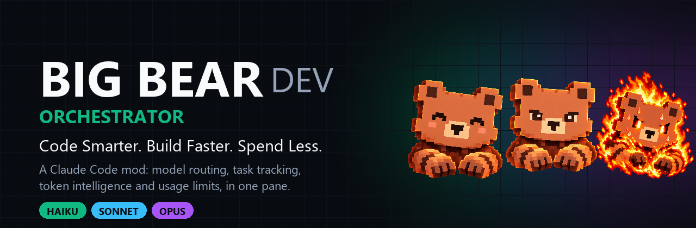

<div align="center">



<br>

[](LICENSE)
[](#instalação)
[](#desenvolvimento)
[](#privacidade-e-segurança)

**Escolha o modelo certo do Claude para cada pedido. Veja tarefas, tokens e limites num painel só. Gaste menos.**

[Instalação](#instalação) · [Recursos](#recursos) · [Comandos](#comandos) · [Como o roteamento funciona](#como-o-roteamento-funciona) · [English](README.md)

</div>

---

## O que é?

**BIG BEAR DEV ORCHESTRATOR** é um mod para o [Claude Code](https://claude.com/claude-code). Ele fica ao lado da sua sessão e faz cinco coisas:

1. **Roteia** cada pedido para Haiku, Sonnet ou Opus, com regras locais gratuitas (sem chamadas extras ao modelo).
2. **Acompanha** cada tarefa e subagente num painel lateral ao vivo, com estados, tempos e ETAs reais.
3. **Mede** tokens, custo equivalente de API e economia estimada, por modelo.
4. **Vigia** suas janelas de uso de 5 horas e semanal, direto dos números do próprio Claude Code.
5. **Protege** o repositório: comandos perigosos, segredos, arquivos críticos, estado do git e execução real de testes.

É um único plugin com módulos independentes. Desligue qualquer um; os outros continuam funcionando.

<div align="center">

| Ocioso | Pesquisando | Trabalhando |
| :---: | :---: | :---: |
|  |  |  |

O topo do painel muda conforme o que o agente está fazendo: lendo e buscando, ou alterando coisas.

</div>

## O painel

```text
╭──────────────────────────────────────────────────────────╮
│ [urso]  BIG BEAR  DEV                  ● Em execução     │
│         meu-projeto  ⎇ main                              │
│         [ BALANCED ] [ SONNET · THE BUILDER ]            │
╰──────────────────────────────────────────────────────────╯
▍TASKS ─────────────────────────────────────────── 4/6 · 67%
 [ 1 EXECUTANDO ] [ 3 CONCLUÍDAS ]
 [ TRABALHANDO HÁ 2m31s ] [ TRABALHOU 14m08s ] [ RESTA ~3m40s ]

 ▌● S  Correção · dano do Mammonite ao errar  ▰▰▰▱▱  2m31s  ETA ~1m50s
 ✓ H  Busca · onde fica calcularDano?        ▰▰▰▰▰  38s    9k tok
 ✓ O  Auditoria · race condition nos drops   ▰▰▰▰▰  6m02s  212k tok
▍TOKEN INTELLIGENCE ───────────────────────────────────────
 ╭ TOKENS ───────────╮ ╭ API EQUIVALENT ───╮
 │ sessão    1.24M   │ │ total      $4.18  │
 ╰───────────────────╯ ╰───────────────────╯
 ╭ SMART SAVINGS ────╮ ╭ MODEL USAGE ──────╮
 │ econ. est. −38%   │ │ HAIKU   ██░░░ 24% │
 │ tokens    ~470k   │ │ SONNET  █████ 61% │
 ╰───────────────────╯ ╰───────────────────╯
▍GUARDIANS ────────────────────────────────────────────────
 ● Git 13 alterações   ● QA passou
 ● Segurança ok        ● Contexto 34%
```

Acima do prompt há também uma faixa de uma linha: modo, modelo ativo, medidores **5H** e **SEMANA**, tempo até o reset e uso do contexto.

O painel se ajusta à altura da janela: com espaço mostra os cards completos, sem espaço troca para um layout denso. Nunca precisa de barra de rolagem.

## Recursos

| Módulo | O que faz de verdade |
| --- | --- |
| **Smart Brain** | Classifica o pedido com regras locais e troca o modelo de cada requisição em `turn.step`. Haiku lê e busca, Sonnet constrói, Opus planeja e audita. Mantém o modelo durante o turno, evita trocar com o cache quente, sobe um nível (no máximo uma vez por turno) quando as ferramentas continuam falhando e aprende com o seu histórico. |
| **Modos de inteligência** | **ECO** (o mais barato que resolve), **BALANCED** (padrão), **GOD** (o mais capaz onde importa; *não* é "Opus em tudo"). |
| **Task Command** | Painel ao vivo: cada tarefa com estado, barra de progresso verificada em 5 marcos, tempo, ETA do histórico, tokens, erros e a árvore dos subagentes que realmente existem. |
| **Token Intelligence** | Tokens de entrada, saída, cache lido e cache criado por tarefa e por sessão; custo equivalente de API com preços editáveis; economia estimada contra um modelo de referência; uso por modelo. |
| **Usage Monitor** | Janelas de 5 horas e semanal com o reset, lidas de `$.session.usage()`. Alertas em 70, 85 e 95 %. Nunca estima o semanal a partir de tokens da sessão. |
| **Code Guardian** | Pergunta antes de force push, exclusão de branch, `reset --hard`, `rm -rf`, `DROP TABLE`, deploy em produção. Bloqueia operações irreversíveis de disco. Avisa sobre segredos e arquivos críticos. |
| **Git Guardian** | Branch, ahead/behind, alterações, conflitos, merge, último commit. Avisa de push em branch protegida e de commit com QA falhando. |
| **Auto QA** | Descobre `typecheck`, `lint`, `test` e `build` no `package.json` e roda de verdade. Inclui perfis por projeto. |
| **Bug Hunter** | `/bigbear bug <erro>`: investigação guiada que começa em Sonnet e sobe para Opus se a causa for arquitetural. |
| **Context Manager** | Avisa quando a janela de contexto enche. Nunca compacta sozinho. Guarda as decisões técnicas que você registrar. |
| **Dev Analytics** | Histórico local: sucesso por tipo de tarefa, tempo médio, mix de modelos, custo. Alimenta o ETA e o roteamento. |
| **Showcase** | Painel limpo para screenshots e um resumo em texto sem caminhos nem segredos. |

Também: **notificação** quando cada tarefa termina, **títulos legíveis** (tipo + resumo limpo, nunca markup cru) e um **painel de configurações** completo.

## Instalação

> **Atenção:** os mods do Claude Code são um recurso em acesso antecipado. Testado no Claude Code **2.1.284** e **2.1.293**. A API pode mudar entre versões.

**1. Ligue os function hooks.** Adicione ao `~/.claude/settings.json`:

```json
{
  "env": {
    "CLAUDE_CODE_ENABLE_FUNCTION_HOOKS": "1"
  }
}
```

**2. Adicione o marketplace e instale** (escopo user, para carregar em todo projeto):

```bash
claude plugin marketplace add jonathasmoraes01/big-bear-dev-orchestrator
```

```bash
claude plugin install big-bear@big-bear-dev --scope user
```

**3. Abra uma sessão nova.** O painel abre sozinho e a faixa de uso aparece acima do prompt. Confira tudo com:

```text
/bigbear doctor
```

Para confirmar quais modelos a sua conta pode usar: `/bigbear doctor probe` (uma chamada mínima por modelo).

**Atualizar:** `claude plugin update big-bear@big-bear-dev` e depois `/reload-plugins`.
**Desinstalar:** `claude plugin uninstall big-bear@big-bear-dev --scope user`.

Funciona no CLI do Claude Code, no terminal integrado do VS Code e no **app Claude para desktop (aba Code)**. No chat da extensão do VS Code o painel não aparece (o host não desenha painéis de mod ali); os comandos `/bigbear` funcionam como texto.

## Comandos

| Comando | Efeito |
| --- | --- |
| `/bigbear` | Abre ou fecha o painel |
| `/bigbear status` | Estado geral |
| `/bigbear mode eco\|balanced\|god` | Troca o modo (com `--project`, vale só para o projeto) |
| `/bigbear model auto\|haiku\|sonnet\|opus` | Fixa um modelo ou volta ao automático |
| `/bigbear block <tier>` · `unblock <tier>` | Proíbe ou libera um modelo |
| `/bigbear off` · `on` | Desliga ou liga o roteamento. Desligado = comportamento original |
| `/bigbear tasks` · `usage` · `models` · `history` · `summary` | Consultas |
| `/bigbear qa [perfil\|list]` | Roda os testes reais do projeto |
| `/bigbear bug <erro>` | Bug Hunter |
| `/bigbear decision <texto>` | Registra uma decisão técnica |
| `/bigbear settings` | Configurações |
| `/bigbear showcase [export]` | Painel para screenshot / resumo em texto |
| `/bigbear doctor [probe]` | Diagnóstico da instalação |
| `/bigbear set-model <tier> <id>` | Troca o id do modelo de um nível |
| `/bigbear alerts 70 85 95` | Limiares dos alertas de uso |
| `/bigbear price <tier> <in> <out> <read> <write>` | Atualiza preços (USD por milhão de tokens) |
| `/bigbear reset` · `project reset` | Restaura o padrão |

No painel: `1` ECO, `2` BALANCED, `3` GOD, `a` auto liga/desliga, `s` configurações, `w` showcase (foque o painel antes com `ctrl+x` `tab`).

## Como o roteamento funciona

```text
pedido ─▶ classificador local ─▶ política do modo ─▶ proteções ─▶ modelo desta requisição
          (sem chamar modelo)     ECO/BAL/GOD         bloqueios,
                                                      modelo manual,
                                                      cache quente,
                                                      histórico de falhas
```

| | 🟢 HAIKU · Scout | 🔵 SONNET · Builder | 🟣 OPUS · Architect |
| --- | --- | --- | --- |
| **ECO** | busca, leitura, docs, edições pequenas | features, bugs, testes | só crítico e complexo |
| **BALANCED** | busca, leitura, edições simples | features, bugs, refatorações, testes | arquitetura, auditorias, crítico |
| **GOD** | conversa trivial | construções simples | tudo que for complexo ou arriscado |

- O id do modelo de cada nível é **configurável**. Os padrões são `claude-haiku-5-5`, `claude-sonnet-5-5` e `claude-opus-5-5`; o BIG BEAR nunca inventa ids. Use `/bigbear doctor probe` para conferir na sua conta.
- Trocar de modelo recria o cache de prompt. O BIG BEAR evita a troca com o cache quente e a conversa grande, e limita a escalada no meio do turno a uma por turno.
- Existe um classificador por IA opcional para pedidos de baixa confiança. Vem **desligado** porque custa uma chamada.

## Números honestos

O BIG BEAR não inventa métricas.

- **API equivalent** é quanto os mesmos tokens custariam na tabela da API. **Não** é o que a sua assinatura cobra.
- **Smart Savings** compara esse custo com um modelo de referência (Sonnet por padrão, configurável) para os mesmos tokens. É uma **estimativa**. O roteamento deixa a requisição mais barata, não menor; então "tokens poupados" é a fração economizada da conta de referência expressa em tokens. Não é reembolso nem garantia sobre o seu limite semanal.
- **5H e SEMANA** vêm só das janelas de limite reportadas pelo Claude Code. Sem leitura, aparece `N/D — indisponível`.
- **ETA** vem só de tarefas concluídas no seu histórico. Enquanto não há o suficiente, o painel mostra "calculando".
- Uma tarefa só fica **COMPLETED** quando o motor informa que o turno terminou com resposta (e, se o Auto QA estiver ligado, que o QA passou).
- Os preços padrão vêm da tabela de modelos da Anthropic embutida no Claude Code (conferida em 2026-10-06). Escrita de cache e leitura de cache do Haiku são derivadas pelos multiplicadores padrão. Edite quando quiser com `/bigbear price`.

## Privacidade e segurança

- **Nada sai da sua máquina.** Sem telemetria, sem servidores externos, sem chamadas de rede próprias.
- O histórico guarda só métricas (categoria, modelo, duração, tokens, custo). Nunca código, prompts ou credenciais. Títulos de tarefa e saídas de QA passam por um filtro de segredos.
- O Code Guardian nunca aprova nada por você: "Permitir" só deixa o comando seguir para a checagem normal de permissão do Claude Code. Ele não contorna aprovações nem hooks de outros plugins.
- Desligue o roteamento e o Claude Code se comporta exatamente como antes.
- Um módulo que falha é pulado pelo motor; os outros continuam.

## Perfis de projeto

O Auto QA lê o `package.json` (`typecheck`, `lint`, `test`, `build`) e oferece os perfis `quick`, `standard` e `full`. Um perfil do jogo do autor, **Ragnarok Classic Idle** (combate, bot idle, party, frontend), acompanha como exemplo de perfil por projeto: veja [`hooks/src/config/project-profiles/ragnarok.ts`](hooks/src/config/project-profiles/ragnarok.ts). Adicione o seu ao lado.

## Arquitetura

Veja [docs/ARCHITECTURE.md](docs/ARCHITECTURE.md). Em resumo: `hooks/register.tsx` é a única camada que captura eventos e segura o handle do motor (`$`); cada módulo recebe um objeto `Io` pequeno e guarda suas regras em funções puras e testadas.

## Desenvolvimento

```bash
git clone https://github.com/jonathasmoraes01/big-bear-dev-orchestrator
cd big-bear-dev-orchestrator
npm install
```

```bash
npm run typecheck
```

```bash
claude plugin validate .claude-plugin/plugin.json
```

```bash
claude plugin test .
```

Para rodar uma cópia local: `claude --plugin-dir .` (com `CLAUDE_CODE_ENABLE_FUNCTION_HOOKS=1`). Recrie os avatares pixel art com `python tools/build-avatars.py` e o banner com `python tools/build-banner.py` (precisa do Pillow).

Resultados dos testes e o que foi verificado em sessões reais: [docs/TEST-RESULTS.md](docs/TEST-RESULTS.md).

## Limitações conhecidas

- API em acesso antecipado; exige `CLAUDE_CODE_ENABLE_FUNCTION_HOOKS=1`.
- Com o roteamento ligado, a escolha do BIG BEAR substitui o `/model` a cada requisição. Use `/bigbear off` ou `/bigbear model <tier>` para retomar o controle.
- 5H e SEMANA exigem assinatura e aparecem depois da primeira resposta da sessão.
- `WAITING` indica uma ferramenta em execução; o mod não vê se ela espera sua aprovação.
- Não existe API oficial para capturar a interface como imagem; o Showcase serve para screenshot manual e o `export` gera texto.
- A largura e o encaixe do painel são decididos pelo Claude Code.

## Contribuindo

Issues e pull requests são bem-vindos. Rode os três comandos de [Desenvolvimento](#desenvolvimento) antes de abrir um PR e mantenha regras novas em funções puras com teste. Ids de modelo, preços e as regras do Guardian são os pontos que mais precisam de atualização conforme o Claude Code e os modelos evoluem.

## Licença

[MIT](LICENSE) © 2026 jonathasmoraes01. A arte dos ursos em `assets/` acompanha o projeto.

<div align="center">

**🐻 Code Smarter. Build Faster. Spend Less.**

</div>
